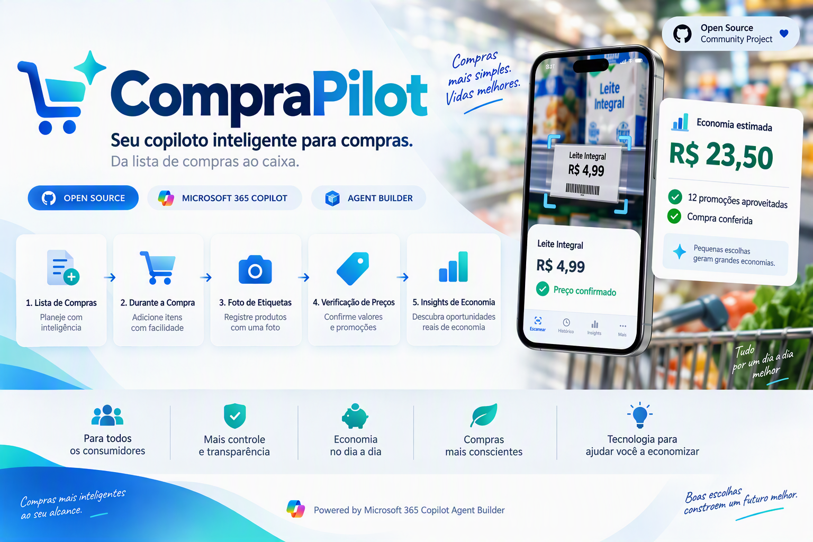

# 🛒 CompraPilot

Seu copiloto inteligente para compras em supermercados.

O CompraPilot é um agente para Microsoft 365 Copilot Agent Builder que ajuda consumidores a planejar compras, registrar produtos através de fotos de etiquetas, acompanhar gastos em tempo real, conferir preços e identificar oportunidades reais de economia.



---

## ✨ O que o CompraPilot faz

✅ Registra produtos a partir de fotos de etiquetas

✅ Solicita quantidade quando necessário

✅ Aplica promoções automaticamente

✅ Calcula subtotais e total acumulado

✅ Mantém um carrinho virtual com modo compacto para compras extensas

✅ Gera relatório detalhado ao final

✅ Compara o valor esperado com o valor cobrado no caixa

✅ Analisa fotos de cupons fiscais

✅ Identifica divergências de preço

✅ Acompanha listas de compras

✅ Identifica itens esquecidos

✅ Gera insights para economia

---

## 🎯 Objetivo

O CompraPilot nasceu para resolver um problema simples:

> "Será que estou pagando o mesmo preço que vi na prateleira?"

Com o amadurecimento da ideia, o projeto evoluiu para um assistente completo de compras capaz de acompanhar toda a jornada do consumidor:

- Planejamento
- Compra
- Conferência
- Economia

---

## 📸 Como funciona

### 1. Registrar lista de compras

O usuário pode informar sua lista:

```text
Arroz
Café
Leite
Papel Higiênico
```

O agente acompanha quais produtos já foram encontrados.

---

### 2. Iniciar compra

```text
Iniciar compra
```

O CompraPilot abre um novo carrinho de compras.

---

### 3. Registrar produtos

Envie uma foto da etiqueta e informe a quantidade.

Exemplo:

```text
Quantidade: 3
```

O agente extrai:

- Produto
- Preço
- Promoção
- Quantidade mínima
- Regras da oferta

---

### 4. Acompanhar gastos

Durante a compra:

```text
Produtos: 7

Total acumulado:
R$ 154,73
```

---

### 5. Finalizar compra

```text
Finalizar compra
```

O agente apresenta:

- Resumo dos produtos
- Subtotais
- Promoções aplicadas
- Total estimado

---

### 6. Conferir caixa

```text
Valor informado pelo caixa:
R$ 165,73
```

O CompraPilot compara:

```text
Valor esperado:
R$ 154,73

Diferença:
R$ 11,00
```

---

### 7. Conferir cupom fiscal

O usuário envia uma foto do comprovante.

O agente:

- Extrai os itens
- Analisa preços
- Detecta divergências
- Identifica promoções não aplicadas

---

## 🚀 Recursos

| Recurso | Status |
|----------|----------|
| Registro por foto | ✅ |
| Controle de quantidade | ✅ |
| Promoções simples | ✅ |
| Relatório final | ✅ |
| Conferência de caixa | ✅ |
| Conferência de cupom | ✅ |
| Lista de compras | ✅ |
| Itens faltantes | ✅ |
| Modo Caixa | ✅ |
| Insights de economia | 🚧 |
| Histórico de compras | 🔮 |

---

## 📂 Estrutura do Projeto

```text
CompraPilot
│
├── agent
│   ├── descricao.md
│   ├── instrucoes.md
│   ├── prompts-sugeridos.md
│   └── configuracao-agent-builder.md
│
├── skill
│   ├── SKILL.md
│   └── scripts
│       └── calcular_compra.py
│
├── docs
│
├── exemplos
│
└── assets
```

---

## ⚙️ Instalação

### Pré-requisitos

- Microsoft 365 Copilot
- Acesso ao Agent Builder
- Habilidade de upload de Skills habilitada

### Passos

1. Crie um novo agente no Agent Builder.
2. Copie a descrição de `agent/descricao.md`.
3. Copie as instruções de `agent/instrucoes.md`.
4. Configure os prompts sugeridos.
5. Faça upload da skill localizada em:

```text
skill/
```

6. Realize os testes utilizando fotos reais de etiquetas.

---

## 💡 Casos de Uso

### Supermercados

- Conferência de preços
- Controle de gastos
- Acompanhamento de promoções

### Atacarejos

- Verificação de preços por quantidade
- Promoções por volume

### Farmácias

- Comparação de descontos
- Validação de ofertas

---

## ✅ Validação em Compras Reais

O CompraPilot já foi validado em ambientes reais de:

- Supermercado
- Atacarejo

Cenários testados:

- Promoções por quantidade mínima
- Produtos próximos ao vencimento
- Correção de itens no carrinho
- Remoção de produtos
- Conferência de valor no caixa
- Conferência de comprovantes
- Controle de lista de compras

### Principais aprendizados

- Respostas compactas melhoram significativamente a experiência durante a compra.
- O Modo Caixa facilita a localização rápida de possíveis divergências.
- Produtos em promoção especial exigem atenção adicional na conferência.
- A análise do comprovante complementa a conferência realizada no caixa.

## 🗺️ Roadmap

### Versão 1.0

- Registro por foto
- Promoções
- Carrinho virtual
- Relatório final

### Versão 1.1

- Lista de compras
- Itens faltantes

### Versão 1.2

- Conferência automática de cupom fiscal

### Versão 1.3

- Insights de economia
- Detecção de promoções pouco vantajosas

### Versão 2.0

- Histórico de compras
- Perfil de consumo
- Recomendações inteligentes

---

## 🤝 Como Contribuir

Contribuições são bem-vindas.

Leia:

```text
CONTRIBUTING.md
```

antes de enviar Pull Requests.

---

## 📄 Licença

Este projeto é distribuído sob a licença definida no arquivo LICENSE.

---

## 👨‍💻 Autor

Criado por **Maycon de Novaes Batista**.

---

## ⭐ Apoie o Projeto

Se o CompraPilot ajudou você nas suas compras:

⭐ Deixe uma estrela no repositório.

🐛 Abra issues para reportar melhorias.

🚀 Contribua para a evolução do projeto.
